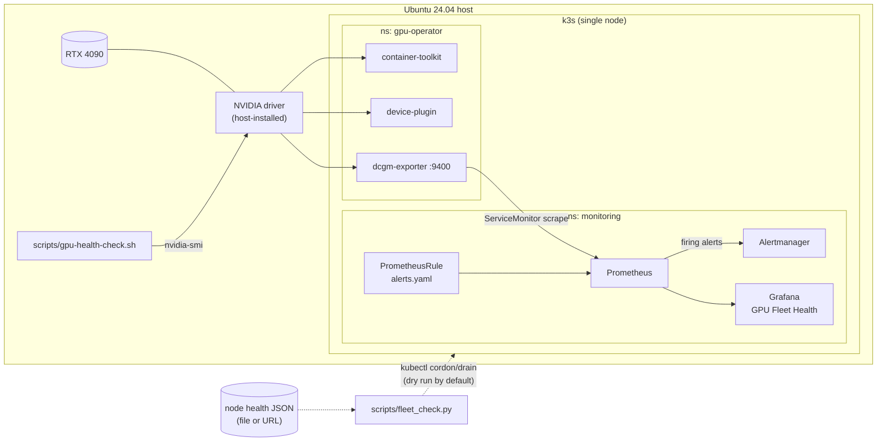

# gpu-fleet-health

**Status:** Work in progress — home lab bring-up on RTX 4090

GPU node health monitoring and remediation tooling for Kubernetes, built on a single-node
k3s cluster (RTX 4090, Ubuntu 24.04, host-installed NVIDIA driver). The same pieces scale
out to a multi-node fleet: dcgm-exporter metrics, Prometheus alerts with runbooks, a local
`nvidia-smi` probe, and a fleet-level remediation planner with blast-radius guards.

This README is written as the **incident runbook**. If an alert sent you here, jump to
[Alert runbook](#alert-runbook).

## Architecture



## Quickstart

Prerequisites: Ubuntu 24.04, NVIDIA driver already installed (`nvidia-smi` works on the
host), `nvidia-container-toolkit` *not* required on the host (the operator installs it),
`helm` and `kubectl` on `PATH`.

```bash
git clone https://github.com/jimmy-do/gpu-fleet-health.git && cd gpu-fleet-health

make install-k3s          # k3s + kubeconfig at ~/.kube/config
make install-operator     # GPU Operator: driver.enabled=false, toolkit on, dcgm-exporter
make install-monitoring   # kube-prometheus-stack, ServiceMonitor, alerts, dashboard
make health-check         # local nvidia-smi probe
make test                 # fleet_check.py unit tests
```

Pin versions with `make install-operator GPU_OPERATOR_VERSION=v26.7.1` (same for
`K3S_VERSION`, `KPS_VERSION`).

Verify the GPU is schedulable and metrics are flowing:

```bash
kubectl get node -o jsonpath='{.items[0].status.allocatable.nvidia\.com/gpu}'   # expect 1
kubectl -n gpu-operator get pods                                                 # all Running/Completed
kubectl -n monitoring port-forward svc/kube-prometheus-stack-grafana 3000:80     # dashboard "GPU Fleet Health"
kubectl -n monitoring port-forward svc/kube-prometheus-stack-prometheus 9090     # query DCGM_FI_DEV_GPU_TEMP
```

## Alert runbook

All alerts are defined in [`k8s/monitoring/alerts.yaml`](k8s/monitoring/alerts.yaml).
Metrics come from dcgm-exporter; `node` is the Kubernetes node name, `gpu` the GPU index.

**General rule:** confirm on the host before taking a node out of service. Both scripts in
this repo print `kubectl cordon` / `kubectl drain` commands for you to review; neither
drains anything unless explicitly told to.

### GPUTemperatureHigh

| | |
|---|---|
| **Fires when** | `DCGM_FI_DEV_GPU_TEMP > 83` for 5 minutes |
| **Severity** | warning |
| **Means** | Sustained high core temperature. The 4090 starts reducing clocks in the high 80s, so jobs will slow down before anything breaks. |

1. Confirm: `nvidia-smi --query-gpu=temperature.gpu,fan.speed,power.draw,clocks_event_reasons.active --format=csv`.
2. Check whether it is load or cooling: high `power.draw` near the limit with fans at 100% means
   cooling can't keep up; low power with high temp suggests a fan or airflow fault.
3. Check the room/case: intake blocked, dust, ambient temperature, fan curve.
4. Short-term: cap power with `sudo nvidia-smi -pl 350` (resets on reboot) to keep running at reduced throughput.
5. If temperature keeps climbing or a fan has failed: `make health-check` and run the printed
   cordon/drain commands so workloads move off the node while you fix the hardware.

### GPUXidErrorReported

| | |
|---|---|
| **Fires when** | `DCGM_FI_DEV_XID_ERRORS > 0` (the value is the **last** XID code seen) |
| **Severity** | critical |
| **Means** | The NVIDIA driver logged an XID error. Some are application bugs; some mean the GPU is failing. |

1. Read the code from the alert value, then confirm in the kernel log:
   `sudo journalctl -k | grep -i xid` (or `sudo dmesg -T | grep -i NVRM`).
2. Triage by code:

   | XID | Meaning | Usual cause | Action |
   |---|---|---|---|
   | 13, 31, 43 | Graphics engine exception / GPU memory page fault / GPU stopped processing | Application (bad kernel, OOB access) | Check the job that was running; node usually fine |
   | 45 | Preemptive cleanup after an earlier error | Follow-on | Look for the XID that preceded it |
   | 48, 94, 95 | ECC double-bit / contained / uncontained memory error | Hardware (data center cards) | Drain, reset GPU, RMA if repeated |
   | 61, 62, 119, 120 | Internal microcontroller / GSP errors | Driver or firmware | Drain, reboot, check driver version |
   | 79 | GPU has fallen off the bus | Hardware, power, PCIe riser/slot | Drain, reboot; reseat/check PSU cabling if repeated |

3. Application XIDs (13/31/43) on their own: notify the workload owner; no node action needed.
4. Hardware/driver XIDs: run `make health-check`, review, then run the printed
   `kubectl cordon` / `kubectl drain` commands. Reboot; if the XID returns, replace the card.
5. The metric keeps the last XID until dcgm-exporter restarts. After remediation, clear it with
   `kubectl -n gpu-operator rollout restart daemonset/nvidia-dcgm-exporter`.

### GPUUncorrectableECCErrors

| | |
|---|---|
| **Fires when** | `increase(DCGM_FI_DEV_ECC_DBE_VOL_TOTAL[10m]) > 0` |
| **Severity** | critical |
| **Means** | Uncorrectable (double-bit) memory errors. Data in GPU memory may be corrupt; job results are suspect. |

> **On this RTX 4090 this alert cannot fire.** Consumer GeForce cards don't report ECC, so the
> metric is absent. The rule is kept for parity with data center fleets (A100/H100).

1. Confirm: `nvidia-smi -q -d ECC` and check for retired pages / remapped rows: `nvidia-smi -q -d PAGE_RETIREMENT,ROW_REMAPPER`.
2. Cordon and drain the node immediately; treat output of jobs that ran on it as untrusted.
3. Reset the GPU (`nvidia-smi -r` with no processes on it) or reboot so row remapping takes effect.
4. If errors recur after the reset, or remapping reports a failure, RMA the card.

### GPUMetricsAbsent

| | |
|---|---|
| **Fires when** | No `DCGM_FI_DEV_GPU_TEMP` series for 5 minutes |
| **Severity** | critical |
| **Means** | Every other GPU alert is blind. Either the exporter is down, the scrape is broken, or the GPU is gone. |

1. Exporter running? `kubectl -n gpu-operator get pods -l app=nvidia-dcgm-exporter`.
2. Scrape healthy? Prometheus UI → *Status → Targets* → `serviceMonitor/monitoring/dcgm-exporter`.
3. GPU visible? `make health-check`: exit `2` means the GPU is missing, exit `3` means the driver can't be queried
   (often a driver/library version mismatch after an unattended upgrade; reboot fixes it).

## Scripts

### `scripts/gpu-health-check.sh`

Local probe using `nvidia-smi`. Prints the cordon/drain commands it **would** run; never runs them.

| Exit | Meaning |
|---|---|
| 0 | All GPUs present and under the temperature limit |
| 1 | A GPU is over `TEMP_LIMIT_C` (default 83) |
| 2 | GPU count differs from `EXPECTED_GPUS` (default 1) |
| 3 | Can't query: `nvidia-smi` missing, NVML/driver failure, unreadable value |

```bash
EXPECTED_GPUS=1 TEMP_LIMIT_C=83 ./scripts/gpu-health-check.sh
```

### `scripts/fleet_check.py`

Fleet-level remediation planner. Reads a node health report (file or http(s) URL) and plans
cordon/drain for unhealthy nodes. Python 3.9+, standard library only.

```bash
./scripts/fleet_check.py tests/fixtures/unhealthy.json            # dry run (default)
./scripts/fleet_check.py http://health-api:8080/nodes --timeout 5  # from an endpoint
./scripts/fleet_check.py report.json --execute                     # actually run kubectl
```

Safety rails:

- **Dry run by default.** `--execute` is required to touch the cluster.
- **Incomplete records are skipped with a reason** (missing field, wrong type, invalid node name), never guessed at.
- **Refuses to act if more than 10% of evaluated nodes are unhealthy** (`--max-unhealthy-pct`).
  When a third of the fleet goes red at once, the cause is usually the monitoring pipeline or a
  shared dependency, and draining that much capacity turns an alert into an outage.
- **Connection refused and timeouts** are reported cleanly (exit 3), not as stack traces.

| Exit | Meaning |
|---|---|
| 0 | All evaluated nodes healthy |
| 1 | Unhealthy nodes found; commands printed (or run with `--execute`) |
| 2 | Refused: unhealthy fraction over the limit |
| 3 | Report unreadable: connection refused, timeout, bad JSON, no usable records |
| 4 | A kubectl command failed (`--execute` only) |

On a single-node cluster one unhealthy node is 100%, so the guard always refuses; pass
`--max-unhealthy-pct 100` deliberately if you want it to act.

## Known limits

- **Consumer card, partial DCGM support.** DCGM targets data center GPUs. On GeForce, the basics
  (temperature, power, utilization, framebuffer, XID) work, but profiling fields (`DCGM_FI_PROF_*`),
  NVLink, row-remapping and some clock/health fields come back blank or N/A.
- **No ECC.** The RTX 4090 doesn't report ECC counters, so `GPUUncorrectableECCErrors` is
  present for parity but can't fire here. Confirm with `nvidia-smi -q -d ECC`.
- **Single node.** Fleet logic (`fleet_check.py`, the 10% guard) is exercised with fixtures, not
  a real multi-node fleet. Draining the only node leaves nowhere for pods to go.
- **XID metric is sticky.** `DCGM_FI_DEV_XID_ERRORS` holds the last XID until the exporter restarts.
- **No notifications wired yet.** Alertmanager uses the chart's default null receiver.

## Layout

```
k8s/gpu-operator/values.yaml                 GPU Operator Helm values (host driver, toolkit on)
k8s/gpu-operator/dcgm-metrics-configmap.yaml dcgm-exporter metric list (adds XID/ECC)
k8s/monitoring/kube-prometheus-stack-values.yaml
k8s/monitoring/dcgm-servicemonitor.yaml      Prometheus scrape of dcgm-exporter
k8s/monitoring/alerts.yaml                   PrometheusRules (this runbook)
k8s/monitoring/dashboards/gpu-health.json    Grafana dashboard
scripts/gpu-health-check.sh                  Local nvidia-smi probe
scripts/fleet_check.py                       Fleet remediation planner
tests/                                       Unit tests and JSON fixtures
docs/screenshots/                            Dashboard screenshots (to come)
```
